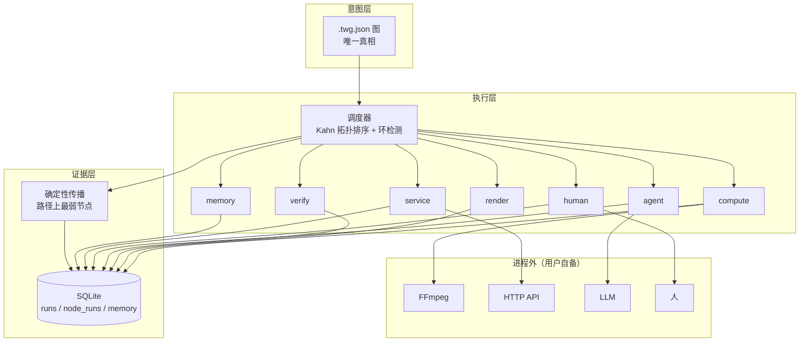

# Tianshu Workflow Graph

> 一个跑在天枢（Tianshu）里的节点图工作流引擎。
> 每个节点除了输入输出，还要回答三个问题：**谁做的、凭什么信、失败了算谁的**。

---

## 为什么需要它

ComfyUI 的节点是**纯函数**——张量进、张量出。这让它在算子层极致灵活，但也让它无法表达：

- 「第 7 步让一个人确认」
- 「这条路径的结果能不能重跑出一样的」
- 「上次卡在哪个节点、为什么」

TWG 把节点重新定义成**工作单元**，并给每个节点补上三样东西：**确定性等级、执行证据、失败记录**。

一句话：**TWG 卖的不是「能生成」，是「能说清楚怎么来的」。**

## 架构



三层职责不越界：**L1 只描述，L2 只执行，L3 只记录**。

## 快速开始

### 前置

- 天枢 **4.0.2+**（实测 4.0.4）
- **FFmpeg**（TWG 不打包二进制，需自备）
  - 下载后把 `bin` 加进 PATH，或设 `TWG_FFMPEG` 指向 `ffmpeg.exe`

### 安装

复制本目录到天枢用户插件目录，重启天枢：

```
<TianshuData>/.rivet/plugins/tianshu-workflow-graph/
```

重启后工具列表出现：`twg_run` / `twg_validate` / `twg_runs`。

> 插件目录由宿主配置（`RIVET_HOME` 或 `%LOCALAPPDATA%\.rivet`）决定，不同安装方式可能不同。

### 跑第一张图

```bash
node run.mjs examples/hello.twg.json
```

实测输出（宿主进程内，宿主运行时 v24.22.1）：

```
图已加载: hello | 4 个节点
执行顺序: intro → solid → title → final
  intro    ffmpeg.testsrc     90.3 ms  [deterministic]
  solid    ffmpeg.color       47.9 ms  [deterministic]
  title    ffmpeg.drawtext   123.4 ms  [deterministic]
  final    ffmpeg.concat      39.8 ms  [deterministic]
产物: ...\final.mp4
```

## 图的写法

```json
{
  "version": "0.1",
  "id": "hello",
  "nodes": [
    { "id": "intro", "type": "compute", "op": "ffmpeg.color",
      "params": { "duration": 2, "size": "320x240", "rate": 10, "color": "teal" } },
    { "id": "title", "type": "render", "op": "ffmpeg.drawtext",
      "inputs": ["intro"], "params": { "text": "TWG", "size": 40 } },
    { "id": "gate", "type": "verify", "op": "verify.media",
      "inputs": ["title"], "params": { "minDuration": 1.5 } }
  ],
  "outputs": { "main": "gate" }
}
```

- `inputs` 声明依赖，引擎做拓扑排序并**检测环**
- `outputs` 是产物的命名出口
- 图是纯文本，可 diff、可 review、可进 git

## 七类节点

| 类型 | op | 确定性 | 说明 |
|---|---|---|---|
| compute | `ffmpeg.testsrc` / `ffmpeg.color` | deterministic | 生成测试/纯色素材 |
| render | `ffmpeg.concat` / `ffmpeg.drawtext` | deterministic | 拼接、加字 |
| verify | `verify.media` | deterministic | 大小/时长门禁，不达标**中断整图** |
| agent | `agent.llm` | **stochastic** | 调模型判断（走注入的 `complete`） |
| human | `human.approve` | deterministic | 人工审批（**插件内未开放**，见边界） |
| service | `service.http` | **stochastic** | 第三方 HTTP（仅 http/https） |
| memory | `memory.get` / `memory.set` | **stochastic** / deterministic | 跨运行状态，支持 `text`/`base64` |

## 确定性：四态

一条输出路径的等级 = 路径上**最弱**的那个节点。

| 等级 | 含义 |
|---|---|
| `deterministic` | 同输入必同输出 |
| `seeded` | 给定种子必定同输出 |
| `stochastic` | 同输入可能不同输出（模型、网络） |
| **`null`** | **没跑完**——失败时记 null |

最后一条是设计上的关键取舍：**「结果不确定」和「根本没跑完」不是一回事**。混在一起，账本的确定性列就会说谎。

实测（同一张图，两条路径）：

```json
{
  "overall": "stochastic",
  "perOutput": {
    "video":  "deterministic",
    "review": "stochastic"
  }
}
```

## 证据账本

每次运行写进 SQLite（`runs` / `node_runs` / `memory` 三张表）：

```sql
SELECT id, status, determinism, error FROM runs;
SELECT node_id, op, ok, error FROM node_runs WHERE run_id = ?;
```

**失败也一样留档**，并且精确到节点：

```
run: {"status":"failed","determinism":null,"error":"[gate] 时长过短: 1.7 < 2"}
  gen1..final  ok=1
  gate         ok=0  | [gate] 时长过短: 1.7 < 2
```

### 写入纪律

一次运行 = **一个事务**。实测（宿主运行时，WAL，1KB/行）：

| 方式 | 300 节点耗时 |
|---|---|
| 逐条写 | 477 ms（阻塞整个会话） |
| **事务批量** | **5.5 ms** |

并发打开同一个库时 `busy_timeout` 是必须的——否则 10 个进程同时切 WAL 会全部 `database is locked`。

## 与其它工作流系统的关系

| 系统 | 节点是什么 | TWG 的差异 |
|---|---|---|
| ComfyUI | 纯函数 | 节点是工作单元；确定性是图属性；失败入账本 |
| n8n | 服务调用 | 有类型化端口与媒体算子；`verify` 能对视频做门禁 |
| Remotion / MoviePy | 代码 | TWG 是图；程序化渲染只是 `render` 节点的内部实现 |
| Shotstack | 云渲染 API | TWG 本地执行 + 证据层 |
| Sora / 可灵 | 端到端黑盒 | TWG 把黑盒当作一个 `compute` 节点 |
| Synthesia | 模板播报 | TWG 里它是一张参数化子图 |

**范式是节点的实现细节，不是图的类型。** 一旦把范式做成一等公民，图就分裂成六种互不兼容的东西。

## 边界（明确不做）

| 不做 | 原因 |
|---|---|
| 不做推理引擎 | 插件与宿主同进程，跑不了重推理 |
| 不打包 FFmpeg / ComfyUI | 80MB+ 二进制不该进插件包 |
| 不做 NLE 时间线 | DAG 与时间线是两种数据结构 |
| 不做云端账号 / 社区 | 用 git 分发工作流即可 |
| 不做节点级人工审批 | TPI 1.0 只有工具级 `requiresApproval` |

`human.approve` 在插件里会明确报错——**不是 bug，是能力边界**。伪造自动批准会让确定性等级说谎。

## 开发

```bash
node --test test/*.test.mjs       # 55 项
```

| 文件 | 职责 |
|---|---|
| `lib/graph.mjs` | 图校验 + Kahn 拓扑排序 + 环检测 |
| `lib/executor.mjs` | 执行器、ffmpeg 解析、确定性汇总、账本写入 |
| `lib/nodes.mjs` | 10 个 op 的实现 |
| `lib/determinism.mjs` | 等级合成与路径传播 |
| `lib/ledger.mjs` | SQLite 账本（runs / node_runs / memory）+ 迁移 |
| `lib/services.mjs` | 服务注入，内核不绑定宿主 |

> 插件目录里有一份 `lib/` 运行副本，改内核后需同步过去。

## 验证状态

| 项 | 状态 |
|---|---|
| 单元测试 | **55 项**，本机 Node v24.22.2 与宿主运行时 v24.22.1 **均全过** |
| 宿主进程内执行 | **已验证**：`twg_run` 返回 `ledger: "written"`，产物落盘 |
| 宿主路径守卫 | **已验证**：工作区外路径被拒 |
| 失败入账 | **已验证**：`status=failed` + `determinism=null` + 节点级 error |
| 并发写 memory | **已验证**：10 进程全成功，last-write-wins |
| 真实模型调用 | **未验证**：宿主未装配 `sidePathLLM` |
| 节点级人工审批 | **未实现**：宿主无此通道 |

## 文档

- [架构设计](docs/architecture.md) — 完整设计、边界、取舍、代价
- [视频工作流调研](docs/video-workflow-research.md) — 国内外应用与六种范式的分析
- [v0.1 设计（已废弃）](docs/architecture-v0.1-superseded.md) — 保留仅供追溯

## 许可

私有仓库，未公开授权。
