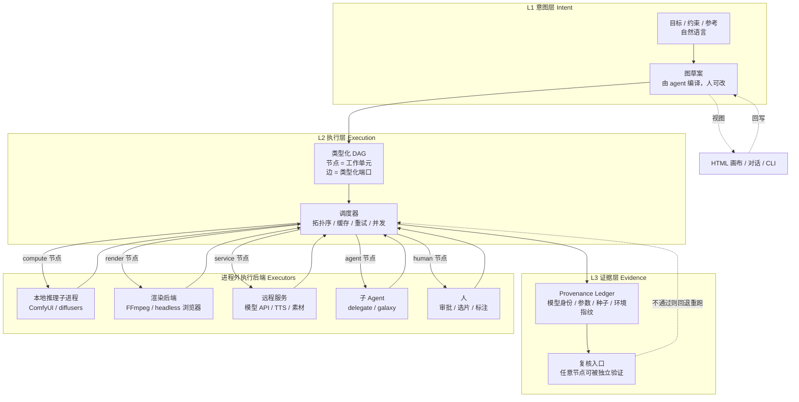

# TWG：天枢工作流图架构设计 v0.1（已废弃）

> ⚠️ **本文已被 `twg-architecture-v0.2.md` 取代，不要据此实现。**
> 本文依据的是旧世代插件接口（`package.json` 的 `tianshu` 字段 + `export const tools`），
> 与 TPI 1.0 实际契约不符。保留仅供追溯设计演进。

**代号**：TWG（Tianshu Workflow Graph），中文名「璇玑图」
**版本**：v0.1 设计稿（已废弃）
**日期**：2026-11-06
**定位**：天枢插件形态的「节点图 + 在线工作流」混合范式
**状态**：架构与边界设计，不含接口定义

---

## 0. 一句话主张

> ComfyUI 的节点是**算子**，LiblibAI 的节点是**托管算子**，天枢的节点应当是**可问责的工作单元** —— 它除了有输入输出，还必须回答三个 ComfyUI 不需要回答的问题：**谁做的、凭什么信、挂了怎么办**。

这个差别不是修辞。它决定了三种系统能表达什么：

| 系统 | 一个节点能是什么 | 因此无法表达 |
|---|---|---|
| ComfyUI | 纯函数（张量进，张量出） | 人的判断、agent 的取舍、质量门禁 |
| LiblibAI | 托管在云上的纯函数 | 同上，另加"跨执行体编排" |
| n8n | 一次服务调用 | 媒体算子的细粒度控制、证据链 |
| **TWG** | 计算 / 渲染 / 服务 / **agent** / **人** / **验证** / **记忆** | 无（代价是复杂度） |

---

## 1. 设计前提：宿主给了什么，拿走了什么

架构不能凭空设计。以下每一条都是实测事实，来自 `D:\tianshu-harness\Tianshu-harness-main\docs\plugins.md`（下文引用其章节名）与 `plugins/` 目录下 6 个现有插件的 manifest。

### 1.1 宿主提供的（可直接利用）

| 能力 | 事实来源 | 对 TWG 的意义 |
|---|---|---|
| 插件 = 独立 npm 包，可依赖任意 npm 库 | plugins.md「与 Skill 的区别」 | 图引擎、解析器、渲染器都能直接内联，不必自带运行时 |
| 工具以 `execute(params)` 形式注册 | plugins.md「Tool 接口」 | TWG 的对外动作（建图/改图/跑图）就是一个工具族 |
| 可捆绑 skill（提示词方法论） | plugins.md「Skill 捆绑」 | 工作流的"人机协作方法论"可以作为 skill 随插件分发 |
| `rawPath` 触发 artifact 持久化 | plugins.md「Tool 接口」 | 成片、画布 HTML、证据账本都能自动落盘并可下载 |
| `fs` 权限工具自动获得内核级路径守卫 | plugins.md「内核级路径守卫」 | 工作流文件与素材的读写安全由宿主兜底，TWG 不重复实现 |

### 1.2 宿主拿走的三条硬约束（决定架构形态）

**约束 A：同进程运行，无进程级沙箱。**

> "v1 版本插件与核心同进程运行……无进程级沙箱 —— 恶意插件可以读取进程内存、访问环境变量。安装即信任。"（plugins.md「同进程约束」）

**推论**：TWG **不能自己跑推理**。任何 GPU 计算、FFmpeg 调用、ComfyUI 执行，都必须以**子进程**或**远程服务**的形式发生在进程之外。这意味着架构里必须存在一个**执行后端（Executor）抽象层**——它不是可选优化，是生存必需。

同时这条约束反向定义了安全姿态：既然"安装即信任"，那么**TWG 的价值主张里不能包含"我们比 ComfyUI 更安全"**。插件一旦申请 `shell` 权限，就等于把宿主的信任面扩大到任意命令执行。这是要明说的代价，不是可以含糊过去的实现细节。

**约束 B：工具名全局唯一，且工具清单在会话启动时固化。**

> "工具在下个会话启动时注册（**不在会话中途改工具清单**，保护前缀缓存）"（plugins.md「安装与生命周期」）
> "插件工具名与内置工具同名 → 拒绝整个插件"（plugins.md「冲突检测」）

**推论**：**绝不能做"一个节点类型 = 一个工具"**。ComfyUI 有上千节点类型，照此映射会瞬间撑爆工具表并撞名。TWG 对外必须是**少数几个稳定工具**（建图、改图、运行、查询、导出），节点类型的多样性收在图内部的 schema 里，而不是暴露成工具。

这条约束看似限制，实际上逼出了正确设计：**图的编辑是数据操作，不是工具操作**。

**约束 C：插件没有原生 UI 面板能力。**

plugins.md 的 manifest 规范共 8 个字段（`name` / `version` / `description` / `entry` / `tools` / `permissions` / `skills` / `minCoreVersion`），**其中没有任何 UI 声明字段**。现有 `design` 插件提供的是对**已有的** HTML/URL 做截图预览（`lib/preview.js` 的 `capturePreviews` → `withBrowser`），HTML 本身由 agent 生成而非插件生成；其 manifest 声明了 `ui_preview` / `ui_diff` / `ui_palette` / `ui_responsive_audit` 四个工具，权限 `{fs, net}`。

**推论**：LiblibAI 那种"打开网页就能拖节点"的体验，在天枢里只能通过**导出一个自包含 HTML 画布文件、由浏览器打开**来实现。这个画布**不能是状态源**——它只能是一个视图/编辑器，状态永远是磁盘上的 `.twg.json`。

这一条是整个架构里体验损失最大的地方，必须在代价里如实计入。

### 1.3 由约束推导出的三条设计公理

1. **图是文本，文本是真相。** 工作流 = 一个可读的 JSON 文件。任何界面（对话、HTML 画布、CLI）都只是它的视图。
2. **算子在进程外，编排在进程内。** TWG 负责"决定做什么、按什么顺序、失败怎么办、结果可不可信"；不负责"怎么算"。
3. **每个节点都要留下能被追问的证据。** 不是日志（log），是账本（ledger）——可被另一个 agent 或人复核。

---

## 2. 架构总览

### 2.1 三层图结构



**三层各自的职责边界（不可越界）**：

| 层 | 只做 | 绝不做 |
|---|---|---|
| L1 意图层 | 把目标编译成图草案、解释图在做什么 | 不执行、不持有运行时状态 |
| L2 执行层 | 求值、调度、缓存、重试、并发控制 | 不判断结果好坏（那是 L3 与 verify 节点的事） |
| L3 证据层 | 记录、复现、审计 | 不干预执行（只读） |

### 2.2 七类节点：这是"变种"的实质

ComfyUI 只有一类节点（算子）。TWG 有七类，因为天枢的运行时有七种"能做事的东西"。

| 类型 | 执行体 | 确定性 | 典型用途 | ComfyUI 有吗 |
|---|---|---|---|---|
| `compute` | 推理子进程 / 模型 API | seeded | 生成、增强、超分、插帧 | ✅（它只有这个） |
| `render` | FFmpeg / 无头浏览器 | deterministic | 合成、转码、字幕烧录、代码生视频 | ⚠️（靠第三方节点） |
| `service` | 第三方 HTTP | stochastic | TTS、素材检索、内容审核 | ⚠️（靠第三方节点） |
| `agent` | 子 agent | stochastic | 写分镜、选素材、评优劣、改图 | ❌ |
| `human` | 用户 | deterministic | 审批、选片、标注关键帧 | ❌ |
| `verify` | 断言引擎 | deterministic | 质量门、合规门、时长/分辨率断言 | ❌ |
| `memory` | 天枢记忆 | deterministic | 品牌一致性、历史素材复用、风格锚定 | ❌ |

**关键设计判断：`agent` 节点是把 P4（Agent 编排）从"外部框架"内化成"图里的一种节点"。**

这一条同时解决了两件事：
- 对 ComfyUI 系：它永远做不到"第 7 步让一个 agent 判断这段素材是否符合品牌调性"——因为它的节点是纯函数。
- 对 n8n 系：它有 agent，但它没有类型化端口、没有媒体算子、没有证据链。

**但必须立刻说清代价**（详见 §5）：`agent` 节点是不确定的，它的引入会污染整图的可复现性。所以它不是免费的强大，是**用确定性换表达力**。架构必须能约束它。

### 2.3 确定性分级：TWG 相对 ComfyUI 的核心增量

调研报告里得出的结论是"视频工作流的真实瓶颈是可复现性，不是生成质量"。ComfyUI 恰恰在这一点上最弱（节点包版本、模型文件、CUDA 版本全要人工管）。

TWG 把它变成架构的一等公民：

**每个节点声明一个确定性等级**：

| 等级 | 含义 | 谁能是 |
|---|---|---|
| `deterministic` | 同输入必同输出 | render / verify / memory / 标注为确定性的 human |
| `seeded` | 给定种子必定同输出 | compute（本地推理） |
| `stochastic` | 同输入可能不同输出 | agent / service（远程 API）/ 未固定种子的 compute |

**图级传播规则**：一条产物路径的确定性 = 路径上最弱节点的等级。任何标 `deterministic` 的产物，其全部上游不许出现 `stochastic` 节点。

**逃生舱**：`stochastic` 节点的输出可以被"快照固化"——一次运行后把结果连同证据冻结，后续运行直接复用快照而非重跑。这让不确定节点也能进入确定性产物路径，代价是失去"重新生成"的自由。

这条规则的价值：它把"这个成片能不能重跑出一样的结果"从**口头承诺**变成**可以被工具检查的图属性**。ComfyUI 做不到，因为它的图没有这个维度。

---

## 3. 平台化的三个落点：LiblibAI 的三件事怎么在天枢落地

LiblibAI 值得学的是三件事。逐条对应，不照搬。

### 3.1 模型广场 → 能力登记表（Capability Registry）

**LiblibAI 的做法**：模型文件 + 预览图 + 下载量 + 一键在线运行。

**TWG 的做法**：一个本地能力清单，描述"本机/本网络有哪些可执行的节点实现"。

每个能力登记项回答五个问题（注意：这是**登记项字段**，不是接口定义）：

- 它是什么类型（compute / render / service / agent / verify / memory）
- 它需要什么执行后端（本地子进程 / 远程端点 / 无）
- 它的端口类型签名（吃什么、吐什么）
- 它的确定性等级与代价特征（耗时、显存、计费）
- 它的身份指纹（模型文件哈希 / API 版本 / 容器镜像）

**与 LiblibAI 的差异**：不做下载量与排行榜。理由是天枢是单机/小团队工具，社区规模不足以产生有意义的排序信号；伪造的排行榜比没有排行榜更有害。

### 3.2 在线工作流 → 图文件 + HTML 画布视图

**LiblibAI 的做法**：网页画布，实时保存，一键运行，结果在右侧预览。

**TWG 的做法（受约束 C 限制）**：

```
.twg.json（真相，磁盘）
    │
    ├──→ 对话视图：agent 读图、改图、解释图
    ├──→ HTML 画布视图：插件导出自包含单文件 HTML，浏览器打开，可拖拽编辑
    └──→ CLI/工具视图：批量运行、CI 集成
```

**HTML 画布的定位必须钉死：它是编辑器，不是运行时，也不是状态源。**

- 打开时读取 `.twg.json`，关闭前显式"导出"回写。
- 不做实时双向同步（插件无原生 UI，做不到长连接状态同步；硬做会引入一堆脏状态）。
- 冲突策略：文件版本哈希校验，不匹配则拒绝覆盖并提示（与天枢 `edit_file` 的 `expected_version` 同一套哲学）。

**这一条是与 LiblibAI 体验差距最大的地方**，必须承认：LiblibAI 的"在线"是产品形态，TWG 的"在线"是文件 + 浏览器，中间隔了一次手动导出。**换来的是图可被 git 版本化、可被 agent 直接编辑、可被代码审查**——这是 LiblibAI 给不了的。

### 3.3 社区分享 → 工作流包（bundle）

**LiblibAI 的做法**：云端账号 + 一键 fork + 收藏。

**TWG 的做法**：不做云。工作流包 = 一个目录：

```
my-workflow/
  ├── workflow.twg.json     # 图
  ├── capability.lock       # 能力指纹锁（模型哈希、API 版本）
  ├── fixtures/             # 示例输入（保证别人能跑通）
  └── README.md             # 用法与已知限制
```

分发靠 git / 文件传输。**没有账号体系，没有中心服务器，没有"一键 fork"**。

理由：天枢是本地优先的运行时，做云社区意味着承担账号、存储、审核、隐私四份成本，而这些成本对一个插件来说不划算。**能用 git 解决的分发，不要造平台。**

---

## 4. 与 ComfyUI 的关系：不是替代，是外壳 + 委托

这是整个设计里最重要的一个取舍，也是我认为唯一正确的选择。

### 4.1 三层关系

| 层次 | 谁负责 | 说明 |
|---|---|---|
| 编排层（做什么、什么顺序、失败怎么办、结果可不可信） | **TWG** | 天枢的强项：类型、证据、agent、人、验证 |
| 算子层（单个模型怎么跑、节点怎么连、显存怎么省） | **ComfyUI** | 它的强项：生态、显存优化、节点丰富度 |
| 执行层（进程、GPU、编码） | 子进程 / 远程 | 宿主的同进程约束决定了必须在这一层 |

### 4.2 "子图作为节点实现"

TWG 的 `compute` 节点**不要求**把每个算子都建模成 TWG 节点。它允许一个节点内部封装一整个 ComfyUI 子图：

```
TWG 图（粗粒度，任务级）
  [素材] → [生成角色定妆照] → [生成 5 个镜头] → [合成] → [成片]
                    │
                    └── 内部实现：一个 ComfyUI workflow JSON
                        （细粒度，算子级，由 ComfyUI 进程执行）
```

**类比**：TWG 是高级语言，ComfyUI 子图是内联汇编。需要极致控制时写汇编，需要可维护性时用高级语言。

**这个设计同时解决了约束 A 和约束 B**：
- 约束 A（不能跑推理）→ 子图交给外部 ComfyUI 进程跑
- 约束 B（工具数受限）→ 算子不进工具表，进子图文件

### 4.3 兼容性策略

- **导入**：能读 ComfyUI workflow JSON，映射成"一个 compute 节点 + 其内部子图"。
- **不做全量节点映射**。ComfyUI 节点类型无穷多，逐一映射是泥潭。只映射**输入输出边界**（什么进去、什么出来），内部原样透传。
- **导出**：TWG 的 compute 节点可导出为 ComfyUI workflow，便于用户在 ComfyUI 里继续调优。

**边界**：如果用户要的是"每个算子都能在 TWG 里单独调"，那他要的其实是 ComfyUI，应该直接用 ComfyUI。TWG 不试图赢下这个场景。

---

## 5. 优点与代价（逐条配对）

不写"优点若干、代价若干"两张不相关的清单。每一条优点都绑定它的代价——因为在天枢的约束下，没有免费的优点。

### 5.1 表达力：异构执行体统一编排

**优点**：同一张图里，第 1 步调模型、第 3 步让人选片、第 5 步让 agent 判断品牌一致性、第 7 步跑 FFmpeg 合成。这是 ComfyUI / LiblibAI / n8n 都做不到的组合。

**代价**：
- **类型系统复杂度上升一个量级**。纯算子的端口类型是张量形状；加上 agent / human 后，端口类型要能表达"一段文本"、"一个决策"、"一个人工标注的关键帧"。类型检查会变弱（更多 `any` 倾向）。
- **调试难度上升**。一个 7 类节点的图挂了，定位成本远高于纯算子图。必须有图级 trace 才能用，否则是灾难。

### 5.2 可信度：证据层让产物可追问

**优点**：每个节点的产出带 provenance（模型哈希、参数、种子、环境指纹）。"这条视频怎么来的"可以逐节点回答。这对商用交付、版权举证、三个月后重跑都是刚需。

**代价**：
- **存储开销**。每个节点一份证据账本，长图 + 大批量时体积可观（虽然远小于媒体本身）。
- **性能开销**。哈希计算与账本写入是同步开销，短任务上占比可能很高。
- **维护义务**。证据格式一旦定下就难改（历史账本要能读），这是长期债务。

### 5.3 门槛：零安装（相对 ComfyUI）

**优点**：ComfyUI 的门槛是环境（CUDA、自定义节点、模型下载、依赖冲突）。TWG 作为插件，`/plugin install` 即用，图引擎和画布都在包内。

**代价**：
- **门槛没有消失，只是转移**。用户仍然需要 ComfyUI（或等价后端）来跑真实推理，仍然要装模型。TWG 只是把"装 ComfyUI 的界面"换成了"配一个后端地址"。**不能对外宣称"免安装"**，那是误导。
- **依赖宿主版本**。插件的可用性绑死在天枢的插件 API 上，宿主升级可能破坏兼容。

### 5.4 复用：天枢已有能力直接变成节点

**优点**：`agent` 节点直接复用 `delegate_task` / `galaxy`；`memory` 节点复用记忆系统；`verify` 节点复用测试与门禁；`human` 节点复用审批机制。这些不是重新发明的，是本来就有的。

**代价**：
- **与宿主深度耦合**。TWG 离开天枢不可用。这不是"可移植的独立工具"，是"天枢的一部分"。
- **宿主行为变化会传导**。天枢的 agent 策略、记忆结构、审批语义一旦调整，TWG 的节点语义跟着变——跨版本兼容成本高。

### 5.5 工程性：文本即图，git 友好

**优点**：`.twg.json` 是纯文本，可 diff、可 review、可 merge、可回滚。工作流的变更进入代码审查流程。这是 ComfyUI（JSON 但无版本语义）和 LiblibAI（云端状态）都给不了的。

**代价**：
- **视觉编辑体验弱**。文本合并冲突在图上表现为"节点 ID 撞车"，需要专门的可视化冲突解决工具，否则用户会被 JSON 冲突劝退。
- **没有实时协作**。多人同时改一张图要靠 git，不是靠光标。

### 5.6 生态：兼容 ComfyUI 后端

**优点**：不需要从零建算子生态。ComfyUI 有的，TWG 通过子图委托都能用。

**代价**：
- **多一层进程管理**。子进程的生命周期、超时、崩溃恢复、日志采集全要自己做。这是实打实的工程量，也是故障面增加的主要来源。
- **需要 `shell` 权限，且会是现有插件中第一个**。实测 `plugins/` 下 6 个现有插件（design、hello-world、office-docx/excel/pdf/ppt）**全部未申请 `shell`**（均只有 `fs`，design 另有 `net`）。这扩大了信任面（见约束 A）——用户安装 TWG 就意味着允许它起子进程，必须在安装时明说，且要接受“这是生态里的先例”带来的审核压力。

### 5.7 代价汇总：三个最容易低估的

如果只能记住三条风险，是这三条：

1. **同进程约束不是小事**。它决定了"执行后端"这一层必须存在，而这一层是整个系统最脏、最容易出故障的地方（进程泄漏、僵尸进程、超时、跨平台差异）。
2. **HTML 画布的体验天花板很低**。它永远做不到 LiblibAI 那种实时保存，用户会感知到"这是个文件编辑器，不是个在线平台"。要么接受，要么不做画布（只做对话 + CLI）。
3. **七类节点是复杂度炸弹**。每增加一类节点，类型系统、调度器、证据层、UI 都要各改一遍。第一版应该只做 2–3 类，而不是七类全上。

---

## 6. 边界：明确不做什么

边界比功能更能定义架构。

| 不做 | 理由 | 如果做了会怎样 |
|---|---|---|
| **不做推理引擎** | 同进程约束 + 不重复造 ComfyUI | 变成半吊子推理框架，两边都不好用 |
| **不做 GPU 云 / 算力调度** | 天枢是本地优先运行时 | 被迫建账号、计费、配额体系，重心偏离 |
| **不做模型训练 / 微调** | 训练是另一个产品 | 显存管理、分布式、checkpoint 管理全部要自建 |
| **不做 NLE 时间线** | DAG 与时间线是两种数据结构 | 强行统一会让两者都变差（调研报告 §7.4 已论证） |
| **不做云端账号 / 社区** | 用 git 能解决的分发不造平台 | 承担存储、审核、隐私、运维四份成本 |
| **不做实时协作编辑** | 无原生 UI，长连接状态同步不可行 | 引入 CRDT 级别的复杂度，收益不匹配 |
| **不承诺沙箱安全** | v1 宿主无进程级沙箱 | 说了做不到，比不说更糟 |
| **不做全量 ComfyUI 节点映射** | 节点类型无穷，映射是泥潭 | 永远追不上，且破坏"子图委托"的简洁性 |
| **不做"一个节点一个工具"** | 工具名全局唯一 + 会话启动固化 | 撞名、工具表爆炸、无法热更新 |

### 一个容易越界的地方（要特别警惕）

**"再加一个范式"的诱惑**。用户提到"要添加一些其他方式的东西"——六种范式（P1 节点 / P2 程序化 / P3 云渲染 / P4 Agent / P5 黑盒 / P6 模板）看起来都该支持。

但架构上的正确做法是：**范式是节点的实现细节，不是图的类型**。

- P2 程序化（Remotion）= 一个 `render` 节点的内部实现
- P3 云渲染 = 一个 `service` 节点的内部实现
- P5 黑盒 = 一个 `compute` 节点的内部实现
- P6 模板 = 一个"参数化子图"，本质是图的复用机制

如果把范式做成图的一等公民（比如"这是一张 P2 图"），图就分裂成六种互不兼容的东西，调度器和证据层要各写六遍。**这是本设计最重要的一条内聚原则。**

---

## 7. 三个关键取舍与推荐

用户不要接口细节，要的是判断。以下三个是必须现在定、且不可逆的。

### 取舍一：节点粒度（细粒度算子 vs 粗粒度任务）

| 选项 | 优点 | 缺点 |
|---|---|---|
| 细粒度（对齐 ComfyUI 每个算子） | 控制力最强 | 工具表爆炸（违反约束 B）、插件要变成推理框架（违反约束 A） |
| 粗粒度（一个节点 = 一个完整任务） | 实现简单、可维护 | 失去 ComfyUI 的核心优势，用户会觉得"还不如直接用 ComfyUI" |
| **双粒度 + 子图委托（推荐）** | 两者兼得：编排粗、算子细 | 多一层子图管理，调试要跨两层 |

**推荐：双粒度 + 子图委托。** 理由：它把"控制力"这件事外包给了已经做得最好的系统，TWG 只做它独有的那部分（编排 + 证据 + 异构执行体）。

### 取舍二：确定性的严格程度

| 选项 | 优点 | 缺点 |
|---|---|---|
| 全图必须确定性 | 完全可复现 | 排除 agent / 远程服务节点，等于放弃天枢的独有优势 |
| 不管确定性 | 表达力最强 | 产物不可复现，商用场景不可用 |
| **分级 + 路径传播 + 快照逃生舱（推荐）** | 两条路都留 | 规则复杂，用户要学习成本 |

**推荐：分级 + 传播 + 快照。** 理由：它把"可复现"从口号变成可检查的图属性，同时给不确定节点留了合法位置。

### 取舍三：第一版做几类节点

| 选项 | 优点 | 缺点 |
|---|---|---|
| 七类全上 | 概念完整 | 复杂度炸弹，第一版必然难产 |
| **三类起步（compute / render / verify）（推荐）** | 能跑通端到端，验证核心假设 | 天枢的差异化（agent / human）要等到第二版才体现 |
| 只做 compute | 最快出东西 | 与 ComfyUI 无差异，没有存在理由 |

**推荐：compute / render / verify 三类起步。** 理由：compute 证明能调后端，render 证明能做合成，verify 证明证据层有牙。agent / human / memory 放第二版——它们才是差异化，但需要前三类先把地基打好。

---

## 8. 演进路线（三阶段，每阶段有可验收的终点）

| 阶段 | 内容 | 可验收终点 | 风险 |
|---|---|---|---|
| **Phase 1 内核** | 图 schema、拓扑求值、compute/render 两类节点、CLI 运行、能力登记表 | 能用一张图跑出"生成 3 段 + 合成 1 条"的成片 | 子进程管理的跨平台差异 |
| **Phase 2 证据** | 证据账本、verify 节点、确定性分级与路径传播、HTML 画布导出 | 同一张图跑两次，证据账本可证明产物一致或标出不确定路径 | 证据格式设计过早固化 |
| **Phase 3 异构** | agent / human / memory 节点、子图委托 ComfyUI、工作流包分发 | 一张图里同时出现 agent 决策、人工审批、模型生成 | 复杂度失控 |

**阶段间的硬门禁**：上一阶段的验收终点没有真实跑通，不进入下一阶段。理由是这类系统最容易在"概念完整但一步都跑不通"的状态下烂尾。

---

## 9. 待验证的假设（设计未定论的部分）

设计里有四处是**推断而非事实**，实现前必须实测：

| # | 假设 | 怎么验 | 不成立的后果 |
|---|---|---|---|
| 1 | 插件申请 `shell` 权限后，能长期持有子进程并正确回收 | 写最小插件，起一个 10 分钟的子进程，观察宿主重启/会话结束时是否泄漏。**注意：现有 6 个插件均未申请 `shell`，无先例可参考** | 若不能，执行后端必须改走"每次调用起一次性进程"，性能大幅下降 |
| 2 | HTML 画布导出的文件在浏览器里能完成"读图→编辑→回写"闭环 | 做一个 100 节点图的导出 + 编辑 + 回写，测冲突处理 | 若不成立，画布降级为"只读可视化" |
| 3 | ComfyUI workflow JSON 的**边界**（输入输出）能稳定映射 | 取 5 个真实 ComfyUI workflow，验证边界提取 | 若不稳定，子图委托只能手写，无法导入 |
| 4 | 会话启动固化的工具表，能覆盖工作流的全部操作 | 列举建图/改图/跑图/查询/导出全部动作，看能否收敛到 ≤6 个工具 | 若不能，说明架构漏了某类操作，要重新划分工具职责 |

**这四条不验完，Phase 1 不应开工。** 它们不是风险提示，是设计的前提条件。

---

## 10. 一页总结

**是什么**：天枢插件形态的工作流引擎，用类型化 DAG 编排"计算 / 渲染 / 服务 / agent / 人 / 验证 / 记忆"七类工作单元，每个节点留证据，整图可版本化。

**为什么是变种而非复刻**：ComfyUI 的节点是算子，天枢的节点是**可问责的工作单元**。这个差别来自天枢本来就有的东西（agent、记忆、验证、审批），不是硬造的差异。

**怎么落地**：进程内只做编排，算子在进程外（ComfyUI / FFmpeg / 远程 API / 子 agent）；图是文本，画布是视图；不做云，用 git 分发。

**最大的三个代价**：执行后端这一层最脏最容易坏；HTML 画布的体验天花板低；七类节点是复杂度炸弹，第一版只能做三类。

**最不该做的事**：把六种范式做成图的一等公民。范式是节点的实现细节，不是图的类型。

---

**设计稿结束。下一步应是 §9 的四个假设实测，而不是开始写代码。**
