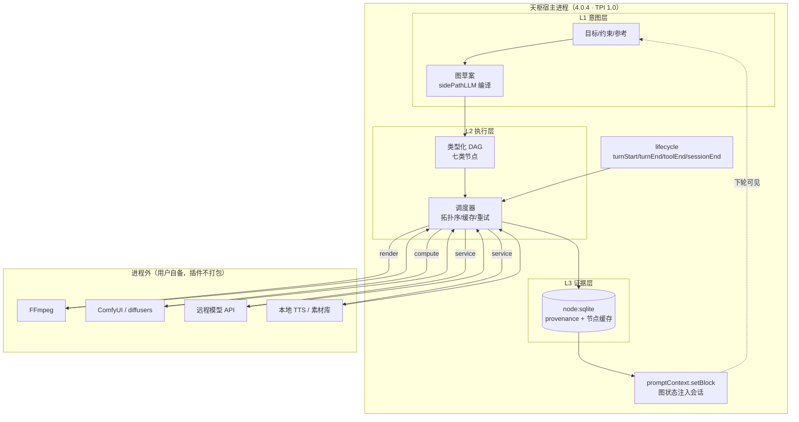

# TWG：天枢工作流图架构设计 v0.3

> **v0.3 变更（2026-11-07）：交付路径定为「本地安装」（路径 B），不走 XPI 官方发行。**
> 这解除了三条发行态约束（零依赖、禁二进制、ZIP ≤20MiB），但**没有**解除运行时约束（同进程、signal 不转发、权限仅声明、无原生 UI）。
> 依据：`/d/Tianshu/plugins/`（内置）与 `TianshuData/.rivet/plugins/`（用户安装）两个目录的实测对比。
>
> **本文取代 `twg-architecture-design.md`（v0.1）。**
> v0.1 依据旧世代接口（`package.json` 的 `tianshu` 字段 + `export const tools`）；v0.2/v0.3 依据官方《Tianshu 插件开发者手册》TPI 1.0 与 Tianshu 4.0.4 本机实测。

**代号**：TWG（Tianshu Workflow Graph），中文名「璇玑图」
**版本**：v0.3（交付路径 B：本地安装）
**日期**：2026-11-06
**目标宿主**：Tianshu 4.0.4（`(Get-Item tianshu-desktop.exe).VersionInfo.FileVersion` 实测）
**状态**：架构与边界设计，不含接口定义

---

## 0. v0.2 修订说明：v0.1 错在哪

v0.1 依据的是旧世代接口（`package.json` 的 `tianshu` 字段 + `export const tools`）。官方 TPI 1.0 手册描述的是**另一个世代**；本机 `/d/Tianshu/plugins/` 下 10 个插件**全部使用新格式** `tianshu.plugin.json`，实测确认新接口才是现行标准。

| 维度 | v0.1 假设（旧文档） | v0.2 实测（TPI 1.0） |
|---|---|---|
| 清单 | `package.json` 的 `tianshu` 字段 | 独立文件 `tianshu.plugin.json`，含 `$tpi`/`kind`/`runtime`，**不接受额外字段** |
| 注册 | `export const tools = [...]` | `defineTianshuPlugin({ id, activate })`；`activate(host)` 返回 `{ tools, lifecycle, dispose }` |
| 工具签名 | `execute(params)` | `execute({ args, cwd, sessionId, signal })` |
| 存储 | 无 | **`host.storage.openDatabase()` → `node:sqlite` `DatabaseSync`** |
| LLM | 无 | **`host.sidePathLLM.complete(prompt, {timeoutMs, signal})`** |
| 向量 | 无 | `host.embeddings.embed(texts, signal)` |
| 上下文注入 | 无 | **`host.promptContext.setBlock()`（仅 turnStart 生效）** |
| 依赖 | 可带 `node_modules` | **禁止依赖目录、包脚本、锁文件、原生二进制、WASM** |
| 体积 | 未限 | ZIP ≤20 MiB、解包 ≤64 MiB、≤2048 项 |

**结论**：v0.1 的骨架（三层图、七类节点、确定性分级、子图委托）依然成立，但**执行形态、存储方式、能力边界**三块必须重写。三条新约束里有两条是决定性的，见 §1.2。

---

## 1. 设计前提：TPI 1.0 给了什么、拿走了什么

以下每条都可复核，出处标注到手册章节或实际文件。

### 1.1 宿主给的（可直接利用，且是 v0.1 没料到的）

| 能力 | 出处 | 对 TWG 的意义 |
|---|---|---|
| `host.storage.openDatabase(name)` → `DatabaseSync` | `devkit/sample/tpi.d.mts` `TpiStorage`；`xiaosi-axiom/index.js:28` 实证 | **证据账本（L3）与节点缓存直接落 SQLite**，v0.1 里"存储开销"的设计难题变成原生能力 |
| `host.sidePathLLM.complete(prompt, {timeoutMs, signal})` | `tpi.d.mts` `TpiSidePathLLM`；`xiaosi-axiom/index.js:32-33` 实证 | **L1 意图层（自然语言→图编译）与 `agent` 节点不需要自建模型调用** |
| `host.promptContext.setBlock(block)` | `tpi.d.mts` `TpiPromptContext`；`xiaosi-axiom/index.js:53` 实证 | 把当前图状态注入会话上下文（**仅 turnStart 生效**，XML 单根，根标签以插件 ID 为前缀） |
| `host.embeddings.embed(texts, signal)` | `tpi.d.mts` `TpiEmbeddings` | 能力检索、工作流语义搜索 |
| `host.transcripts.listSessions/read` | `tpi.d.mts` `TpiTranscripts` | 可从历史会话挖掘工作流需求（只读，当前项目） |
| `host.account.userKey()` | `tpi.d.mts` `TpiAccount` | 多用户隔离的数据库命名（`xiaosi-axiom/index.js:22` 实证用法） |
| 生命周期 `turnStart/turnEnd/toolEnd/sessionEnd` | 手册「生命周期与外部 hook」 | 图状态注入、轮末统计、工具审计、会话末精炼 |
| `contributes.skills` / `commands` / `hookScripts` | 手册「清单与兼容性」 | 方法论随插件分发；`/` 命令入口；外部观察钩子 |

**最重要的一条实证**：`xiaosi-axiom/index.js:9` 的注释——

> "只经 TPI 宿主能力访问天枢：storage（每用户一个 SQLite）、account（用户键）、embeddings、sidePathLLM、promptContext、transcripts。**没有声明的能力宿主不会给。**"

这意味着 `capabilities` 数组是**能力开关**，不是文档声明。TWG 必须在清单里精确列出它需要的每一项（`tools`、`storage`、`sidePathLLM`、`promptContext`，可能还要 `embeddings`）。

### 1.2 宿主拿走的三条硬约束（决定架构形态）

**约束 A（发行态，路径 B 下已解除）：零依赖 + 禁二进制。**

> "禁止依赖目录、运行时安装、包脚本、锁文件、原生二进制、WASM 和原生构建脚本。"（手册「05 打包发布与更新」）

**这条禁令的适用范围是 XPI 发行 ZIP，不是运行时。** 三层证据：

1. 手册把禁令写在 05「打包发布与更新」章，语境是发行包。
2. `rivet-runtime` 全量 grep `native binary` → **命中 0 个文件**——运行时没有这个校验。
3. 旧世代加载器源码 `plugin-loader.ts:437-483` 只查三件事：entry 不逃出 pluginDir、`tools` 能导出、工具名不冲突；`manifest.ts:70` 对 entry 只要求 `z.string().min(1)`，无扩展名限制。（**注**：这是 `Tianshu-harness-main/src/plugins` 的旧世代源码；TPI 1.0 的加载器是 `rivet-runtime` 里的编译产物，未逐行读——但上面的 `native binary` 零命中是对编译产物的直接检查，两条证据独立）

**路径 B（本地安装）已解除的约束，有活证据：**

| 原本以为的限制 | 实际情况 | 证据 / 强度 |
|---|---|---|
| **不能起子进程** | **可以，已坐实** | `disk-steward`（TPI 1.0）`permissions.shell: true`，`core/elevation.mjs:3` `import { spawnSync } from 'node:child_process'`，实际调 `net` / `tasklist` / `sc.exe`，且每个调用都带 `timeout: 5000` |
| 不能用 npm 库 / 带 node_modules | **技术上应可行，但无 TPI 1.0 活证据** | 现存 2 个 TPI 1.0 用户插件（`disk-steward`、`pelican-test`）**都不带** node_modules。带 52M node_modules 的 `tianshu-design` 是**旧世代**（有 `package.json` 的 `tianshu` 字段，**无** `tianshu.plugin.json`），**不能作为 TPI 1.0 的证据**。loader 不检查包内容，推测可行，未实测 |
| ZIP ≤20MiB / 64MiB | **不适用** | 不走发行通道，无此限制 |
| `data_schema:1` + `migration:none` | **不适用** | 无自动更新机制，无迁移校验 |
| 原生二进制（`.exe`/`.node`/`.wasm`） | **技术上应可行，完全无活证据** | 两个 TPI 1.0 用户插件都不含二进制；运行时 grep `native binary` 命中 0。**这是本报告里证据最弱的一条，Phase 1 必须实测** |

> 注：内置插件目录 `/d/Tianshu/plugins/` 下 10 个插件确实全部无 node_modules、无 shell——那是**内置插件**的实践，不是运行时的强制。用户安装目录里的 `tianshu-design` 与 `disk-steward` 证明 B 路径不同。

**仍然成立的部分（运行时层，未解除）**：

1. 图引擎仍然可以零依赖，但**不再被强制**——zod/ajv 等库现在可用了。
2. **外部程序仍需用户自备**：不是不能打包，而是 FFmpeg 本体 82MB、ComfyUI 更大，打包进插件不现实。所以 `render`/`compute` 仍走“路径发现 + 用户配置”。
3. v0.1 设想的“子图交给 ComfyUI 执行”仍然要求用户自己装 ComfyUI。

**约束 B：同进程 + 同步 SQLite + signal 不可靠。**

> "天枢以进程内 JavaScript 运行 agent 插件。"（手册「04 TPI SDK 与运行时」）
> "SDK 的工具调用类型含可选 signal。**当前基线的工具包装器未转发该字段**……**宿主超时无法终止已在同进程运行的任意代码**。"（同上）

而 `TpiStorage.openDatabase` 返回的是 `node:sqlite` 的 **`DatabaseSync`**——同步 API。

**推论**：

1. 任何长耗时操作（FFmpeg 转码、模型推理）**必须走出进程**，否则整个 agent 会话被阻塞。这不是性能优化，是可用性底线。
2. **同步 SQLite 会阻塞事件循环**。证据账本写入必须小批量、短事务；大查询要么分页，要么接受卡顿。这是 v0.1 完全没预料到的代价。
3. **取消机制不可依赖**。`signal` 在当前基线不转发，宿主超时杀不掉同进程代码。TWG 的长任务必须自建超时与清理，且要假设"宿主放弃等待了但我还在跑"。

**约束 C：权限是声明，不是沙箱。**

> "清单 permissions.fs/net/shell 是用户可见的**用途声明**。能力清单约束宿主交给插件的接口，文件、网络、进程与环境访问**仍受天枢进程自身权限支配**。私有目录是存储约定，**隔离取决于宿主环境**。"（手册「04 TPI SDK 与运行时」）

**推论**：`permissions.shell: true` 只影响安装时给用户看的提示，**不构成技术限制**。TWG 若需要调外部程序，声明它是对用户的诚实，不是安全边界。安全必须由 TWG 自己实现（见 §6.3）。

### 1.3 发行侧的三个固定项

| 项 | 值 | 影响 |
|---|---|---|
| `channel` | `stable` | 无 beta 通道，灰度只能靠版本号 |
| `data_schema` | `1` | 证据账本的 schema 版本被钉死 |
| `migration_kind` | `none` | **自动更新要求迁移类型为 none** → 证据账本 schema 一旦发布，改结构就得手动确认更新 |

这三条合起来意味着：**证据账本的 schema 必须在第一次发布前设计到位**，之后几乎没有演进空间。这是 v0.2 新识别出的、最容易被低估的长期风险。

另有一条清单硬规则：**清单不接受额外字段**（手册「03 清单与兼容性」）。所以图 schema、节点定义、能力登记表全部不能塞进 manifest，必须放在插件自己的数据文件或 SQLite 里。

---

## 2. 架构总览（v0.2 修订）

### 2.1 三层图结构



与 v0.1 的差别：**执行后端从"插件管理的子进程"变为"用户自备的外部程序"**，且证据层从"自建存储"变为 SQLite。

### 2.2 七类节点的落地方式（每条都对应到宿主能力）

| 类型 | 执行体 | 落地方式 | 依赖宿主能力 |
|---|---|---|---|
| `compute` | 外部推理程序 / 远程 API | 路径发现 + 配置 + HTTP | `shell`（声明）/ `net` |
| `render` | 浏览器（Edge/Chromium + playwright-core）/ 用户自装 FFmpeg | 宿主内置 playwright-core 可直接驱动；FFmpeg 需用户自备 | `playwright-core`（机会性）/ `shell` |
| `service` | 第三方 HTTP | `fetch` | `net` |
| `agent` | **sidePathLLM** | `host.sidePathLLM.complete()` | `sidePathLLM` |
| `human` | 用户 | `requiresApproval`，或图在节点处挂起等下一轮输入 | 无 |
| `verify` | 断言引擎 | 纯 JS 判断 + 门禁 | 无 |
| `memory` | SQLite | `host.storage.openDatabase()` | `storage` |

**关键取舍变化**：v0.1 里 `agent` 节点打算走 `delegate_task`（子 agent），v0.2 改为**优先走 `sidePathLLM`**。理由：sidePathLLM 是宿主直供的轻量通道（`timeoutMs` 可控、有 `signal`），而起子 agent 要走更重的编排路径且不可控。**只有当 agent 节点需要工具调用能力时，才升级为子 agent。**

### 2.3 会话内状态注入：TWG 与 agent 的接口

这是 v0.2 新增的能力，也是 TWG 相对 ComfyUI 的独特之处：

```
turnStart（预算 2 秒）
   └─ 读出当前活跃工作流的摘要（节点数、卡在哪个节点、上次产物）
   └─ host.promptContext.setBlock(<twg-state>...</twg-state>)
         ↑ 根标签必须以标准化插件 ID 为前缀（手册「04」）
         ↑ 只在这一轮生效，下一轮要重设

agent 看到状态 → 决定下一步 → 调用 twg_edit / twg_run
```

**边界**：`turnStart` 基线预算只有 **2 秒**（手册「生命周期与外部 hook」），所以注入的内容必须是**摘要**，不能是整张图。整图通过工具按需读取。

### 2.4 生命周期的预算分布（决定什么能放在哪）

| 阶段 | 预算 | TWG 用它做什么 | 不能做什么 |
|---|---|---|---|
| `turnStart` | 2 秒 | 注入图摘要 | 不能读整图、不能查大表 |
| `turnEnd` | 未标明 | 记录本轮产物、更新证据 | 不能跑渲染 |
| `toolEnd` | 同步回调 | 审计工具调用（预览最多 400 字符） | 不能做重活 |
| `sessionEnd` | 180 秒 | 会话级证据归档、缓存清理 | 不能启动长任务（会被判超时） |

---

## 3. 平台化的三个落点（v0.2 修订）

### 3.1 能力登记表 → 用 SQLite + `embeddings`

**v0.1 方案**：JSON 文件 + 工具查询。
**v0.2 方案**：`storage.openDatabase("registry.db")` 存能力，`host.embeddings` 做语义检索。

登记项回答六个问题（类型 / 执行后端 / 端口签名 / 确定性等级与代价 / 身份指纹 / **可执行路径**）。

第六项是 v0.2 新增的：因为不能打包，**「外部程序在哪」是运行前提，必须登记**。

**用户首次使用时的真实流程**（必须诚实设计，不能藏起来）：装插件 → 配 FFmpeg 路径 → 配模型 API key → 才能跑第一个图。这不是"零安装"，是"零安装 + 三次配置"。

### 3.2 在线工作流 → 图文件 + HTML 画布 + 状态注入

**v0.2 新增第三种视图**：`promptContext` 注入。三种视图并存：

| 视图 | 载体 | 适合谁 | 更新方式 |
|---|---|---|---|
| 对话视图 | `promptContext` + 工具 | agent 与本会话用户 | 每轮自动注入摘要 |
| HTML 画布 | 导出单文件 HTML | 需要空间感的用户 | 手动导出/回写 |
| 文件视图 | `.twg.json` | git / CI / 代码审查 | 外部编辑 |

**仍不变的原则**：`.twg.json` 是唯一真相，其余皆视图。

### 3.3 工作流包 → 受发行约束的目录

v0.1 的包结构在 v0.2 必须缩水，因为发行包有硬限制：

```
my-workflow/
  ├── workflow.twg.json          ✅ 保留（图本体）
  ├── capability-manifest.json   ⚠️ 改名：不能叫 .lock
  │                                （发行禁止"锁文件"，避免审核歧义；
  │                                  实际是"能力指纹清单"，业务数据）
  ├── fixtures/                  ⚠️ 计入 2048 项上限；不得含凭据
  └── README.md                  ✅ 保留
```

---

## 4. 与 ComfyUI 的关系（v0.2 更保守了）

v0.1 说"子图委托给 ComfyUI"。v0.2 必须加一条前提：**ComfyUI 是用户自备的外部程序，TWG 不打包、不安装、不管理它的依赖**。

| 能力 | TWG | ComfyUI | 说明 |
|---|---|---|---|
| 图编排 | ✅ | ✅ | TWG 粗粒度，ComfyUI 细粒度 |
| 证据/复现 | ✅ | ❌ | TWG 的核心增量 |
| 异构节点（agent/human/verify/memory） | ✅ | ❌ | TWG 的核心增量 |
| 算子生态 | ❌ | ✅ | TWG 完全依赖它 |
| 安装体验 | ✅（插件市场） | ❌（环境地狱） | 但 TWG 仍需用户装 ComfyUI |
| 显存/算子优化 | ❌ | ✅ | 不重复造 |

**结论不变但更狠**：TWG 赢在"编排 + 证据 + 异构"，输在"算子"和"开箱即用"。如果用户要的是"打开就能拖节点出视频"，那他要的是 LiblibAI 或 ComfyUI 桌面版，不是 TWG。

---

## 5. 优点与代价（v0.2 重写）

### 5.1 宿主直供带来的三个"意外之喜"

| 能力 | 省掉了什么 | 代价 |
|---|---|---|
| `node:sqlite` | 自建存储层、文件索引、并发控制 | **`DatabaseSync` 同步 API 会阻塞事件循环**（实测：事务批量 300 节点仅 5.5ms，逐条写 477ms）；schema 被 `data_schema: 1` 钉死 |
| `sidePathLLM` | 自建模型调用、API key 管理 | 通道可能不可用（要先 `available()`）；超时要自己压到 90 秒内（`xiaosi-axiom` 的做法） |
| `promptContext` | 自建 UI 展示图状态 | 只 turnStart 生效、2 秒预算、XML 单根、根标签要带插件 ID 前缀 |

### 5.2 零依赖约束的三重代价

| 代价 | 具体表现 |
|---|---|
| 手写基础设施 | 图算法、schema 校验、HTML 生成、HTTP 客户端全部自己写。参照量级：`trace-lab` 584K、`xiaosi-axiom` 2349 行 |
| 无类型安全网 | 不能用 zod 推导类型，只能靠 JSDoc + 手写校验 + 测试 |
| 无生态复用 | 看到一个好用的 npm 库，用不了 |

### 5.3 禁二进制约束的两重代价

| 代价 | 说明 |
|---|---|
| 门槛没降 | 用户仍需装 FFmpeg / ComfyUI / 配 API key。TWG 只是省了"装 Python 环境" |
| 环境探测复杂 | 要在 Windows/macOS/Linux 找外部程序、处理路径空格、版本不兼容。**实测：ffmpeg 原本不在 PATH、常见路径也没有；ComfyUI 在检查范围内未找到**——外部程序路径不能假设存在。开发机已手动安装 FFmpeg 6.1.1 到 `D:\Tools\ffmpeg\bin`（ffmpeg + ffprobe，gyan.dev essentials build），但**这是开发环境配置，不构成发行依赖**：插件仍不能打包二进制，最终用户仍需自备 |

### 5.4 同进程 + signal 不可靠的代价

| 代价 | 说明 |
|---|---|
| 长任务必须外置 | 所有重活走外部进程，TWG 只做编排 |
| 取消靠自己 | 宿主超时杀不掉同进程代码；TWG 必须自建超时 + 清理，并假设"宿主已放弃但进程还在跑" |
| 同步 SQLite 卡顿 | 大查询阻塞整个会话 |

### 5.5 优点汇总（与代价配对）

| 优点 | 绑定代价 |
|---|---|
| 异构执行体统一编排（七类节点） | 类型系统复杂；调试要图级 trace |
| 证据层可审计 | `DatabaseSync` 阻塞；schema 钉死；迁移受限 |
| 复用宿主能力（存储/LLM/向量/上下文） | 与宿主版本强耦合（`>=4.0.2 <5.0.0`） |
| 插件市场安装 | 仍需自备外部程序与密钥 |
| 文本即图、git 友好 | 视觉编辑弱、无实时协作 |
| 兼容 ComfyUI 算子生态 | 不打包、不管理，用户自负环境 |

---

## 6. 边界：明确不做什么（v0.2 新增四条）

| 不做 | 理由 | 出处 |
|---|---|---|
| 不做推理引擎 | 同进程 + 禁二进制 | 约束 A、B |
| 不做 GPU 云 / 算力调度 | 天枢本地优先 | — |
| 不做模型训练 | 另一产品 | — |
| 不做 NLE 时间线 | 数据结构不同 | v0.1 论证 |
| 不做云端账号 / 社区 | git 能解决 | — |
| 不做实时协作编辑 | 无原生 UI | — |
| 不承诺沙箱安全 | 权限仅是声明 | 约束 C |
| 不做全量 ComfyUI 节点映射 | 泥潭 | — |
| 不做"一节点一工具" | 工具名全局唯一 | 旧约束仍成立 |
| **不做插件内打包 FFmpeg / ComfyUI** | **发行明令禁止原生二进制** | 新增 |
| **不做依赖 npm 库** | **禁止依赖目录** | 新增 |
| **不做需要 >20 MiB 的资源内嵌** | **ZIP 上限** | 新增 |
| **不做数据迁移** | **`migration_kind: none`** | 新增 |

### 6.1 第一条不可越界的内聚原则（不变）

**范式是节点的实现细节，不是图的类型。** P2 程序化 = `render` 节点的内部实现；P3 云渲染 = `service`；P5 黑盒 = `compute`；P6 模板 = 参数化子图。把范式做成一等公民会让图分裂成六种互不兼容的东西。

### 6.2 第二条不可越界的原则（v0.2 新增）

**图的状态归图，会话的状态归会话。** `promptContext` 注入的必须是**摘要**，不是图本身。一旦让会话上下文成为图的载体，就会出现"agent 记得的图"和"磁盘上的图"两个真相——这是最典型的分布式状态失控。

### 6.3 安全必须自建

既然 `permissions.shell` 只是声明（约束 C），TWG 必须自己实现：

1. **外部程序白名单**：只允许执行登记过的路径，不接受任意命令字符串。
2. **参数结构化**：命令用数组形式传参，不拼 shell 字符串（防注入）。
3. **工作流文件路径守卫**：即便宿主有 `pathParams`，也要在业务层再校验一次范围。
4. **产物落盘目录固定**：不允许工作流把产物写到任意路径。

这四条是 TWG 自己的责任，不能推给宿主。

---

## 7. 不可逆取舍（v0.2 结论）

| 取舍 | 推荐 | v0.1 → v0.2 的变化 |
|---|---|---|
| **节点粒度** | 双粒度 + 子图委托 | 不变，但"委托"改为"调用用户自备的 ComfyUI" |
| **确定性** | 分级 + 路径传播 + 快照 | 不变；快照现在落 SQLite |
| **agent 节点实现** | **优先 `sidePathLLM`，需要工具能力时才升级子 agent** | **新增**（v0.1 只想到子 agent） |
| **第一版范围** | compute / render / verify 三类 | 不变 |
| **存储** | **全部走 `node:sqlite` + WAL + 事务批量写**（逐条写不可接受，见 §9-5 实测） | **新增**（v0.1 打算用 JSON） |

---

## 8. 演进路线（v0.2 重排）

| 阶段 | 内容 | 验收终点 | 现实风险 |
|---|---|---|---|
| **Phase 0 探针**（新增） | 验证 §9 的五个假设 | 五个假设全部有实测结论 | 任一不成立则改架构 |
| **Phase 1 内核** | `tianshu.plugin.json` + 图 schema + 拓扑求值 + compute/render + capability registry（SQLite） | 一张图跑出"外部程序生成 3 段 + FFmpeg 合成 1 条" | 外部程序发现、跨平台路径 |
| **Phase 2 证据** | 证据账本（SQLite）+ verify 节点 + 确定性传播 + HTML 导出 | 同图跑两次，账本能证明一致或标出不确定路径 | `DatabaseSync` 阻塞 |
| **Phase 3 异构** | agent（sidePathLLM）/ human / memory + promptContext 注入 + 子图委托 | 一张图里同时有 agent 决策与人工审批 | 复杂度失控 |

---

## 9. 待验证假设（v0.2 更新）

| # | 假设 | 状态 | 依据 / 怎么验 |
|---|---|---|---|
| 1 | 插件能否长期持有子进程 | **可起子进程已验证；长驻托管仍否定** | 修正：内置 `/d/Tianshu/plugins/` 下 10 个插件确实全 `shell: false`，但**用户安装目录的 `disk-steward` 申请了 `shell: true` 且 `core/elevation.mjs`、`core/precondition.mjs` 有 child_process 用法**——起子进程是通的。**但手册明确「宿主超时无法终止已在同进程运行的任意代码」→ 宿主不会托管子进程生命周期**。结论不变：用"一次性调用 + 自建超时清理"，不用长驻进程 |
| 2 | HTML 画布能否完成读图→编辑→回写 | 待测 | 需实做；零依赖意味着 HTML 生成器全手写 |
| 3 | ComfyUI workflow 边界映射 | 待测 | 需真实 workflow 样本 |
| 4 | 全部操作能否收敛到 ≤6 个工具 | 待测 | 参照 `trace-lab` 用 4 个工具覆盖"列/跑/比/导出"；TWG 需要"建/改/跑/查/导出"，估计 5–7 个，处于边界 |
| 5 | **`DatabaseSync` 在证据账本写入频率下不会造成可感知卡顿** | **已验证：有条件成立**（2026-11-06 实测，宿主运行时 v24.22.1，WAL，payload 1KB/行） | **WAL + 事务批量**：10 节点 1.28ms、30 节点 1.48ms、100 节点 1.81ms、300 节点 5.52ms —— 无感。**逐条写**：10 节点 13ms、30 节点 35ms、100 节点 107ms、300 节点 477ms —— 300 节点时接近半秒卡顿。**成本模型**：≤100 节点时 ≈ **固定开销 1.3ms + 每行 ~5µs**（10/30/100 节点模型与实测偏差 ≤5%）；**300 节点时每行升至 ~14µs，模型不再适用**（疑似索引页分裂，未深究）。**关键推论：证据必须"一次运行一个事务"整批落盘；按节点逐个开事务等于把 1.3ms 固定开销乘以 N**。阻塞时长≈总耗时，同步 API 零并发余地 |
| 6 | **插件能否复用宿主已装的 `node_modules`**（`playwright-core`、`mediabunny`） | **技术上可行，稳定性未验证**（2026-11-06 实测） | `createRequire('D:/Tianshu/rivet-runtime/node_modules/')` + `require('mediabunny')` → **成功**，导出 ADTS/ALL_FORMATS/AUDIO_CODECS 等；`require('playwright-core')` → **成功**，chromium available（v1.62.0）。**但**：手册只说「禁止依赖目录」指发行包内，未言明运行时能否 require 宿主包；宿主升级可能改路径/版本/移除包。**结论：只能做"机会性加速"（探测到就用，探测不到回落），不得作为唯一路径** |
| 7 | **宿主 `mediabunny` 能否替代 FFmpeg** | **部分可行，边界已查**（实测） | 本机 ffmpeg 不在 PATH，常见路径也没有；宿主 `native-media/` 为空。mediabunny 是**纯 JS**（main=`dist/bundles/mediabunny.cjs`，无 wasm/二进制，仅两个 @types 依赖），做的是**容器封装/解封装/编解码**；**做不了滤镜链、合成、字幕烧录**（那是 FFmpeg filtergraph 的领域）。**结论：mediabunny 能顶替封装/转码，不能顶替 filtergraph** |

---

## 10. 一页总结（v0.2）

**是什么**：TPI 1.0 插件形态的工作流引擎，七类节点（compute/render/service/agent/human/verify/memory），SQLite 证据账本，文本即图。

**三条硬约束**：零依赖禁二进制（不能打包 FFmpeg/ComfyUI）、同进程同步 SQLite（长任务必须外置）、权限只是声明（安全自建）。

**三个宿主直供的杠杆**：`node:sqlite`（证据层）、`sidePathLLM`（意图层与 agent 节点）、`promptContext`（图状态注入会话）。

**最大的三个代价**：外部程序全靠用户自备，门槛没降；零依赖意味着手写全部基础设施；`data_schema: 1` + `migration_kind: none` 把证据 schema 钉死，第一次发布前必须设计到位。

**最不该做的事**：把会话上下文当成图的载体。图的状态只在磁盘，会话只拿摘要。

---

## 11. 实现现状（v0.3，代码已落地后的对齐记录）

> 本节不是设计，是**代码跑出来之后的事实**。与前面章节冲突时，以本节为准。

### 11.1 目录与产物

| 位置 | 角色 |
|---|---|
| `D:\pro	wg\` | 源码 + 测试（唯一开发源） |
| `D:\Tianshu\TianshuData\.rivet\plugins	wg\` | 运行副本（`diff -rq lib` 保持与源码一致） |

插件清单：`id=twg`、`capabilities=[tools, storage]`、`permissions={fs,net,shell}`、
`engines.tianshu =>=4.0.2 <5.0.0`；工具 **3 个**：`twg_run` / `twg_validate` / `twg_runs`。
**清单里的工具名必须与 `index.mjs` 导出完全一致**——不一致会导致宿主拒绝加载整个插件（曾经踩过：`twg_runs` 只加了代码没加清单）。

### 11.2 七类节点：10 个 op 全部落地

| 类型 | op | 确定性 |
|---|---|---|
| compute | `ffmpeg.testsrc` / `ffmpeg.color` | deterministic |
| render | `ffmpeg.concat` / `ffmpeg.drawtext` | deterministic |
| verify | `verify.media`（大小 + 时长门禁） | deterministic |
| agent | `agent.llm`（走注入的 `complete`） | **stochastic** |
| human | `human.approve`（插件内**不注入**审批，图含此节点会明确报错） | deterministic |
| service | `service.http`（仅 http/https，超时 + 响应上限） | **stochastic** |
| memory | `memory.get` / `memory.set` | **stochastic** / deterministic |

### 11.3 确定性是四态，不是三态

设计里写的是三态（deterministic / seeded / stochastic）。实现补充了第四种：

| 值 | 含义 |
|---|---|
| `deterministic` / `seeded` / `stochastic` | 输出路径上最弱的节点等级 |
| **`null`** | **运行失败、没跑完**——不能用 `stochastic` 冒充"不确定" |

`stochastic` = 跑了但不可复现；`null` = 根本没跑完。两者混为一谈会让账本的确定性列失真。
实现位置：`executor.mjs` 的 `finish()`——`status === 'ok'` 才算确定性，否则返回
`{ overall: null, perOutput: {}, incomplete: true }`。

### 11.4 账本记录失败节点

`node_runs` 表带 `error TEXT` 列，失败节点也会写一条 `ok=0` 记录。
老库通过 `initLedger()` 里的 `migrate()` 自动 `ALTER TABLE ADD COLUMN`（只加列，不做破坏性变更）。

由此账本能直接回答「卡在哪个节点、为什么」，而不是从 `runs.error` 文本里猜：

```
run: {"status":"failed","determinism":null,"error":"[gate] 时长过短: 1.7 < 2"}
  gen1..final  ok=1
  gate         ok=0 | [gate] 时长过短: 1.7 < 2
```

### 11.5 无产物节点的契约

`memory.set` 与 `human.approve` 返回 `file: null`——语义上它们「只写不读」。
executor 在解析 inputs 时显式拦截：

```
节点 X 的输入 Y 不产出文件，不能作为下游输入
```

错误指向真正原因，不让下游节点莫名崩溃。

### 11.6 memory 的边界（必须说清）

`memory` 节点维护的是 **TWG 自己的跨运行状态**（存在 `twg.db` 的 `memory` 表）。
它**读不到也写不了天枢的用户记忆系统**——TPI 没有开放记忆能力，跨插件访问
`xiaosi-axiom` 的私有库不成立。

`valueType` 支持 `text` / `base64`：存二进制必须显式声明 `base64`，否则按 utf8 解码会损坏数据。

### 11.7 账本写入纪律（实测）

一次运行 = 一个事务。实测数据（宿主运行时 v24.22.1，WAL，1KB/行）：

| 方式 | 300 节点耗时 |
|---|---|
| 逐条写（非事务） | 477 ms（阻塞整个会话） |
| **事务批量** | **5.5 ms** |

成本模型：≤100 节点时 ≈ 固定开销 1.3ms + 每行 ~5µs；300 节点时每行升至 ~14µs（模型不再适用）。

### 11.8 验证状态

| 项 | 状态 |
|---|---|
| 测试总数 | **55 项**（graph 10 + ledger 11 + hybrid 14 + service 8 + memory 12） |
| 双运行时 | 本机 v24.22.2 与宿主 v24.22.1 **均 55/55** |
| 端到端 | 7 节点真实流水线跑通（5 类节点，多分支，确定性精确分开） |
| 宿主进程内加载 | **未验证**（按用户决定不重启宿主） |
| 真实 model 调用 | **未验证**（`sidePathLLM` 至今是 mock） |
| 并发写同一 memory key | **未验证** |

---

**设计稿 v0.3 结束。代码在 `D:\pro	wg\`，这份文档记录的是它与设计对齐后的状态。**
